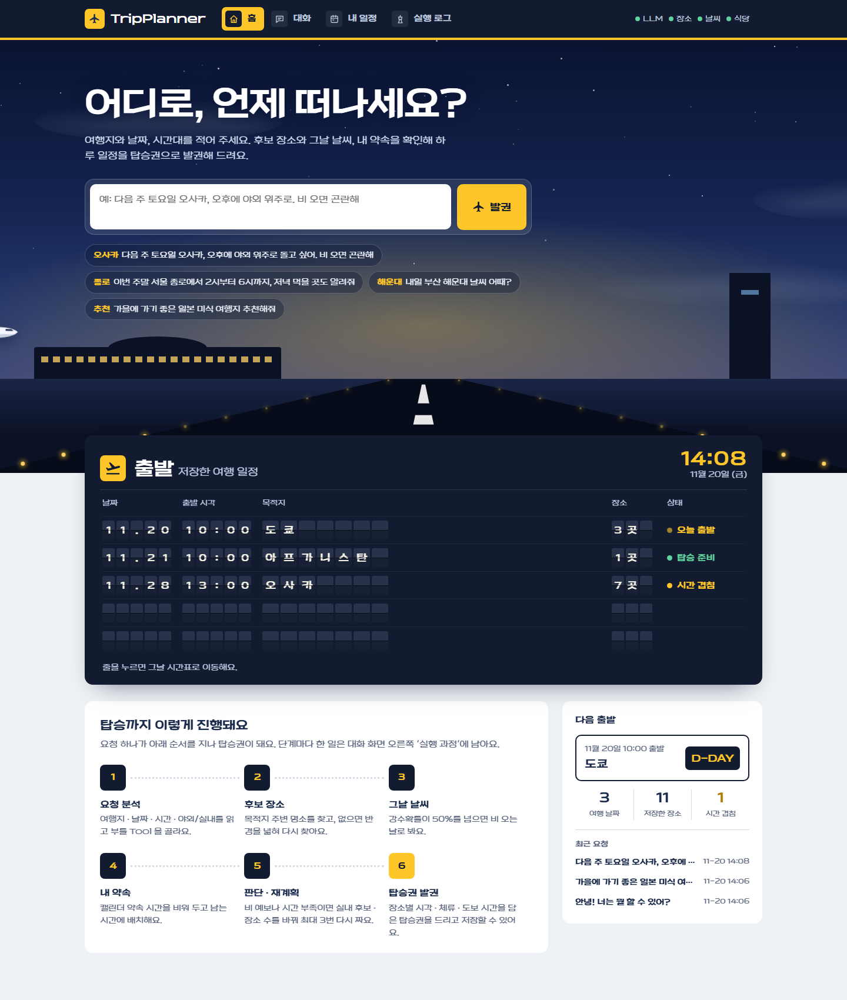
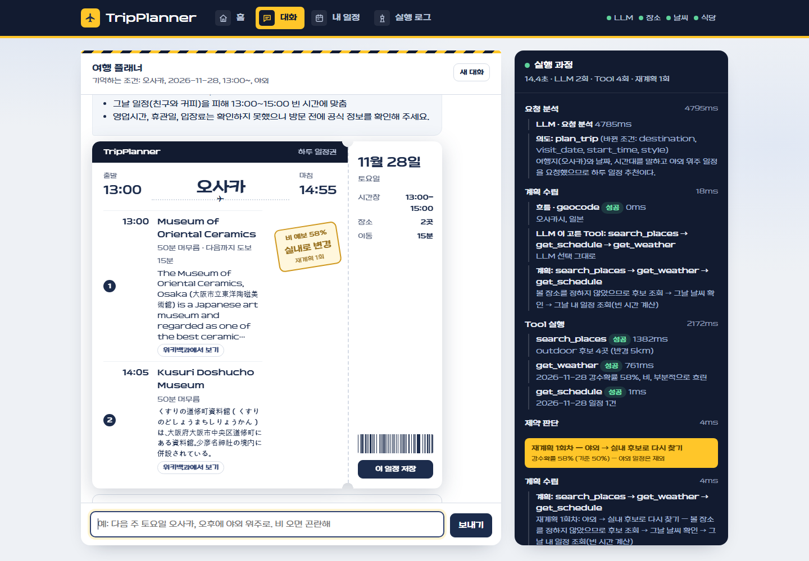
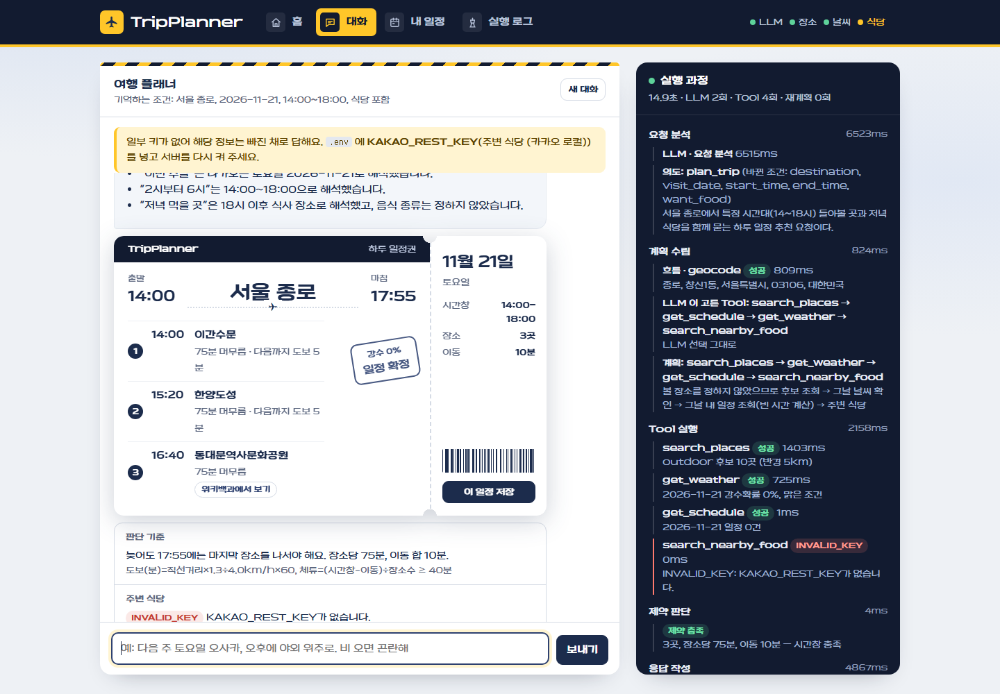
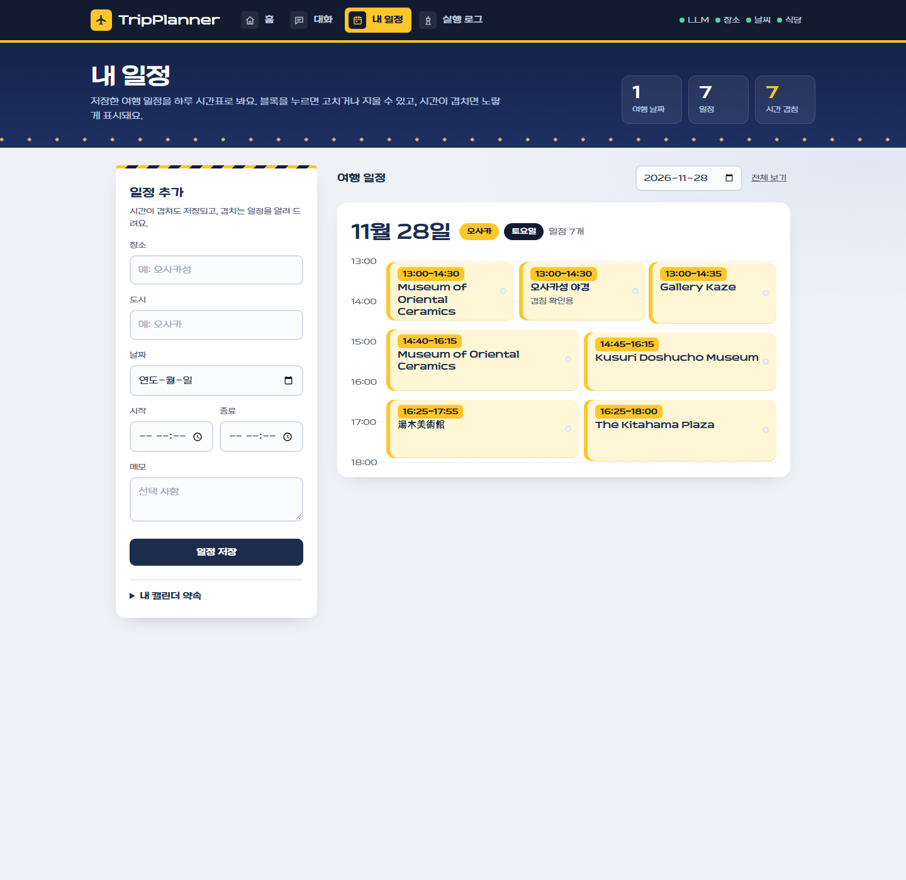
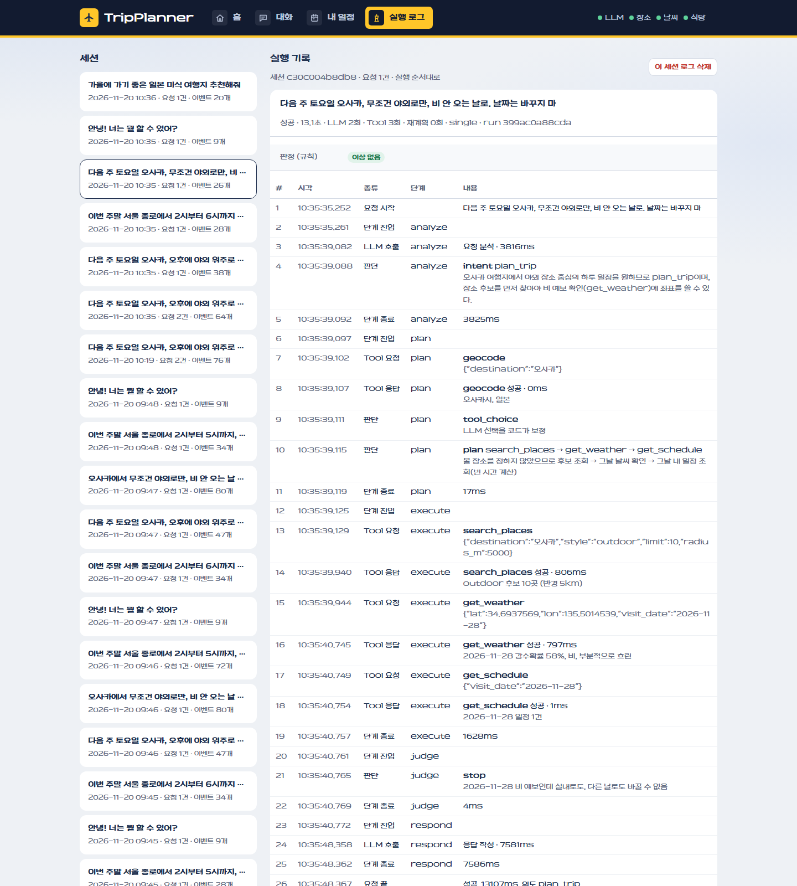
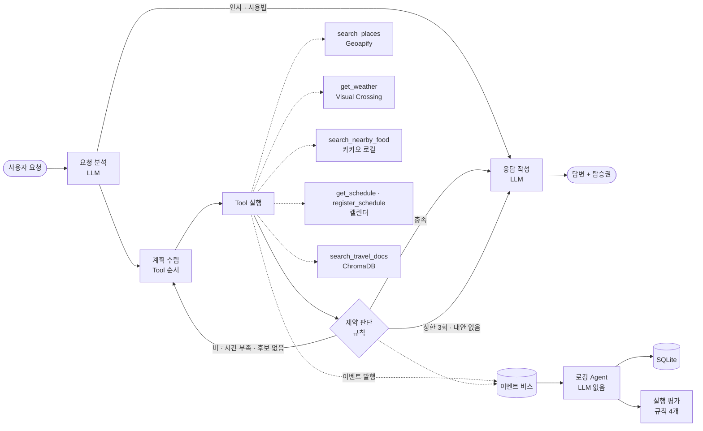

# ✈ TripPlanner — Agent 기반 국내·해외 여행 플래너

> 여행지 · 날짜 · 시간대 · 선호를 말하면 Agent 가 **후보 장소 · 그날 날씨 · 내 약속**을 확인해
> 제약(비 · 시간창 · 도보 동선)에 맞는 **하루 일정을 탑승권으로 발권**하고,
> 맞지 않으면 실내 · 다른 날 · 다른 반경으로 **스스로 다시 계획**한다.

**🔗 배포: https://tripplanner-jpqn.onrender.com** (무료 요금제라 첫 접속은 30~50초 걸릴 수 있어요)

AI 코어 프로젝트 3회차 (개인) · 2회차 [TripPilot](https://github.com/strongsun806/TripPilot)(RAG 여행 플래너)의 도메인과 Vector DB 를 이어 쓴다.



<br>

## 한눈에 보기

| | |
|---|---|
| **무엇을** | "다음 주 토요일 오사카, 오후에 야외 위주로. 비 오면 곤란해" 같은 한 문장을 받아 하루 일정(장소 · 시각 · 체류 · 도보)을 짠다 |
| **어떻게** | LangGraph Agent 가 요청을 분석해 Tool 을 고르고, 결과를 규칙으로 판단해 안 맞으면 재계획 (최대 3회) |
| **보여 주는 것** | 답변과 함께 **실행 과정**(단계 · Tool 호출 · 판단 · 재계획 지점)을 실행 순서대로 |
| **남기는 것** | 로깅 서브 Agent 가 모든 이벤트를 세션별로 저장하고, 실행마다 규칙으로 이상 여부를 판정 |
| **검증** | `check_list.py` **통과 36 · 실패 0** (미확인 2 = 화면 항목, 캡처로 확인) · 오프라인 시험 70건 통과 |

<br>

## 화면

| 대화 — 비 예보로 실내 재계획 | 키 하나가 없어도 일정은 나온다 |
|---|---|
|  |  |
| **내 일정 — 겹치는 일정은 노랑** | **실행 로그 — 이벤트를 실행 순서대로** |
|  |  |

| 화면 | 주소 | 내용 |
|---|---|---|
| 홈 | `index.html` | 출발 안내판(저장한 일정이 글자판으로) · 체크인(요청 입력 → 대화로 바로 전송) · 다음 출발 D-day · 최근 요청 · 탑승 동선 |
| 대화 | `chat.html` | 답변 + 탑승권(장소 · 시각 · 체류 · 도보 · 판단 도장) · 판단 기준 · 식당 · 제외 사유 · 근거 · '이 일정 저장'. 오른쪽 '실행 과정' |
| 내 일정 | `plans.html` | 날짜별 하루 시간표, 겹침 표시, 블록을 눌러 수정 · 삭제, 내 캘린더 약속 |
| 실행 로그 | `logs.html` | 세션 목록 → 실행별 이벤트 표, 규칙 판정 · LLM 진단, 세션 삭제 (수정 없음) |

<br>

## 동작 흐름



**판단 기준** (`app/config.py` 한 곳에서 관리)

| 항목 | 기준 |
|---|---|
| 비 | 강수확률 **50% 초과**면 비 → 야외 후보 제외. 강수확률이 없으면 판단 보류 (0 으로 채우지 않음) |
| 도보 | 직선거리 × 1.3 ÷ 4 km/h, 5분 단위 올림 |
| 체류 | (시간창 − 이동 합) ÷ 장소 수 **≥ 40분**, 장소 최대 3곳, 기본 시간창 10:00–18:00 |
| 재계획 | 비 → 실내 · 야외만 → 다음 날 · 후보 없음 → 반경 5 → 10 → 20 km · 동선 초과 → 2 km. **최대 3회**, 이미 받은 결과는 재사용 |
| 지어내지 않기 | 영업시간 · 체류 시간은 만들지 않고 '늦어도 몇 시에 나서야 하는지'를 역산해 제시 |
| 후보 거르기 | 병원 · 학교 · 관공서 · '…터' 표석처럼 구경 갈 곳이 아닌 데는 빼고, **위키백과 문서가 있는 이름난 곳**을 앞에. 탑승권에 위키백과 한 줄 소개 · 링크 |
| 뺀 장소 기억 | '병원 빼', '거긴 말고'라고 하면 그 대화 내내 후보에서 뺀다 |

<br>

## 빠른 시작

**Windows 에서는 `start.bat` 더블클릭** — 서버(8000)와 화면(5500)을 켜고 브라우저로 홈을 연다.

```bash
# 1) 패키지 (상위 폴더 venv 사용 시)
source ../../venv/Scripts/activate            # PowerShell: ..\..\venv\Scripts\Activate.ps1
pip install -r requirements.txt

# 2) 키 — .env.example 을 .env 로 복사해 채운다 (.env 는 커밋하지 않는다)
cp .env.example .env

# 3) 서버 + 화면 (터미널 두 개, 둘 다 TripPlanner 폴더에서)
uvicorn app.main:app --reload                 # API · http://localhost:8000/docs
python serve_frontend.py                      # 화면 · http://localhost:5500

# 4) (선택) 문서 검색 색인 — 2회차 chroma_db 가 있으면 .env 의 RAG_DB_DIR 로 가리켜도 된다
python rag_index.py
```

| 키 | 받는 곳 | 쓰는 Tool |
|---|---|---|
| `GMS_KEY` · `GMS_BASE_URL` | 교육 과정 GMS (LLM 게이트웨이) 안내 | 요청 분석 · 응답 작성 (Claude `claude-haiku-5-5`) |
| `GEOAPIFY_KEY` | geoapify.com | `search_places` |
| `VISUALCROSSING_KEY` | visualcrossing.com | `get_weather` |
| `KAKAO_REST_KEY` | developers.kakao.com (REST API 키) | `search_nearby_food` |

키가 빠져도 서버는 뜨고, 화면 위쪽 점과 안내 문구로 어떤 키가 없는지 알려 준다.

<br>

## 배포 (Render)

서버 하나가 API 와 화면을 같은 주소로 보여 준다 (`app/main.py` 가 `frontend/` 를 `/` 에 붙인다). 설정은 [`render.yaml`](render.yaml).

[](https://render.com/deploy?repo=https://github.com/strongsun806/TripPlanner)

1. 위 버튼 → GitHub 로 Render 로그인 → 저장소 연결
2. 환경 변수 채우기: `GMS_KEY` · `GMS_BASE_URL` · `GEOAPIFY_KEY` · `VISUALCROSSING_KEY` · `KAKAO_REST_KEY`, 그리고 **`ACCESS_CODE`**(접속 코드)
3. 배포가 끝나면 `https://<서비스 이름>.onrender.com` — 화면은 `/`, API 문서는 `/docs` (현재 배포: https://tripplanner-jpqn.onrender.com)

| 알아 둘 것 | |
|---|---|
| 접속 코드 | `ACCESS_CODE` 를 넣으면 처음 들어올 때 '탑승 게이트'에서 코드를 입력해야 대화 · 저장을 쓸 수 있다 (키 사용량 보호). 비워 두면 누구나 쓴다 |
| 잠들기 | 무료 요금제는 15분 동안 요청이 없으면 잠들고, 다음 첫 접속이 30초쯤 걸린다 |
| 데이터 | 무료 요금제에는 영구 디스크가 없어 저장한 일정 · 실행 로그는 재배포 · 재시작 때 비워진다 (시연용) |
| 문서 검색 | 빌드 때 `rag_index.py` 로 색인을 만든다 |
| GMS | 배포 서버에서 GMS 에 닿지 않으면 LLM 이 실패하고, 화면에 원인별 안내가 뜬다 |


## 검증

| 명령 | 하는 일 | 결과 |
|---|---|---|
| `python tests/test_agent_offline.py` | 가짜 LLM · 가짜 API 로 Agent 흐름 (S · A · D · E) | 39 / 39 |
| `python tests/test_api_offline.py` | `/api/chat` · `/api/plans` · `/api/logs` 연동 | 14 / 14 |
| `python tests/test_planner_worker_offline.py` | Planner / Worker (W1 ~ W7) | 12 / 12 |
| `python tests/test_checklist_offline.py` | 실제 API 로 만들기 어려운 경우 — 빈 속성 판단 보류 · 로그 저장 실패 · 로그 = 이벤트 · 캘린더 교체 (G1 ~ G4) | 5 / 5 |
| `python check_list.py` | 명세서 4장 체크리스트를 코드로 → [`docs/08`](docs/08_체크리스트_결과.md) | **통과 36 · 실패 0 · 미확인 2** |
| `python compare_modes.py` | 대표 요청 5개 × 구성 3개를 실제 LLM 으로 → [`docs/05`](docs/05_구조_비교.md) | 15건 · 오류 0 |
| `run_evidence.bat` | 실제 요청 → 화면 캡처(`docs/images`) · 결과(`docs/evidence`) · 체크리스트를 한 번에 | — |
| `python tools.py` · `python llm_check.py` · `python api_check.py` | Tool 정상 · 실패 / LLM 호출 · Tool 선택 / 외부 API 확인 | — |

항목별 증빙은 [`docs/07_검증_체크리스트.md`](docs/07_검증_체크리스트.md), 대표 시나리오 기록은 [`docs/09_대표_시나리오_검증.md`](docs/09_대표_시나리오_검증.md), 셀프 체크리스트는 [`docs/10_셀프_체크리스트.xlsx`](docs/10_셀프_체크리스트.xlsx).

<br>

## 요구사항 구현 현황

| 구분 | 내용 | 상태 |
|---|---|---|
| 필수 F3001 ~ F3004 | Tool 명세 · 등록, 외부 API Tool 3종 (실패도 예외 없이 `ok: False`) | ✅ |
| 필수 F3005 ~ F3011 | 메인 Agent — 분석 · 계획 · 실행 · 판단 · 재계획 · 대화 맥락 · 응답 | ✅ |
| 필수 F3012 ~ F3014 | 이벤트 발행 · 로깅 Agent · 실행 로그 (목록 · 상세 · 삭제, 수정 API 없음) | ✅ |
| 필수 F3015 ~ F3019 | 계획 저장 · 수정 · 삭제, FastAPI, 화면, 실행 과정 표시 | ✅ |
| 심화 F3020 | 로깅 Agent 평가 — 규칙 4개 판정 + 이상일 때만 LLM 진단 (판정과 분리) | ✅ |
| 심화 F3021 | Planner / Worker 분리 — 정상 경로 Worker LLM 0회, 구조 비교 실험 | ✅ |
| 심화 F3022 | 2회차 Vector DB 검색 Tool — 근거 문서 · 출처 제시 | ✅ |
| 심화 F3023 | 일정 조회 · 등록 Tool — 로컬 구현체, Google Calendar 로 교체 가능 | ✅ |

요구사항별 코드 위치와 확인 방법은 [`docs/03_요구사항_정의서.md`](docs/03_요구사항_정의서.md).

<br>

## 기술 스택

| 영역 | 사용 |
|---|---|
| Agent | LangGraph 1.2 (StateGraph) · LangChain · Claude (GMS 게이트웨이, OpenAI 호환 호출) |
| 백엔드 | FastAPI · Pydantic · SQLite · Uvicorn |
| 검색 | ChromaDB (2회차 TripPilot 색인과 같은 임베딩) |
| 화면 | HTML · CSS · JavaScript (프레임워크 없음) · 글꼴 Y이든스트릿 · Pretendard |
| 외부 API | Geoapify · Visual Crossing · 카카오 로컬 |

| Tool | API | 범위 | 무료 한도 |
|---|---|---|---|
| `search_places` | Geoapify Geocoding + Places | 전 세계 | 3,000 크레딧/일 |
| `get_weather` | Visual Crossing Timeline | 전 세계 · 15일 | 1,000 레코드/일 |
| `search_nearby_food` | 카카오 로컬 키워드 검색 | 국내 | 100,000건/일 |

교육장 네트워크에서 Open-Meteo 가 막혀 날씨는 Visual Crossing 으로 바꿨다 ([`docs/01`](docs/01_도메인_확정.md)).
LLM 은 GMS 의 GPT 사용량이 소진되어 Claude 로 바꿨고, 구조화 출력은 `tool_choice` 없이 Tool 호출 → JSON 평문 순으로 받는다 ([`docs/04`](docs/04_Agent_설계.md)).

<br>

## 폴더 구조

```
TripPlanner/
├─ tools.py                  외부 API Tool 3종 + Tool 약속(ok/fail) + 키 가리기(scrub)
├─ app/
│  ├─ main.py                FastAPI 앱 · CORS · 라우터 · 로깅 Agent 연결
│  ├─ config.py              판단 기준값 · 상한 · LLM 설정 (한 곳)
│  ├─ schemas.py · store.py  요청 · 응답 형식 / SQLite (plans · events · calendar · evaluations)
│  ├─ logging_agent.py       로깅 서브 Agent (구독 · 저장, LLM 없음)
│  ├─ evaluator.py           실행 평가 (F3020)
│  ├─ rag.py                 Vector DB 검색 · 색인 (F3022)
│  ├─ calendar_backend.py    캘린더 구현체 local · google (F3023)
│  ├─ agent/                 graph(메인 Agent) · planner_worker · judge · llm · memory · events · registry · local_tools · runner
│  └─ api/                   chat · plans · logs · calendar · meta 라우터
├─ frontend/                 index(홈) · chat(대화) · plans(내 일정) · logs(실행 로그) · style.css · common.js
├─ tests/                    오프라인 시험 (가짜 LLM · 가짜 외부 API)
├─ docs/                     01 도메인 · 02 Tool · 03 요구사항 · 04 Agent 설계 · 05 구조 비교 · 06 API · 07 검증 · 08 결과
│  ├─ images/                화면 캡처 (증빙)
│  └─ evidence/              실제 실행 결과 (JSON · 그래프 · 체크리스트 출력)
├─ start.bat · run_evidence.bat · serve_frontend.py · render.yaml
├─ check_list.py · compare_modes.py · capture_evidence.py · rag_index.py · api_check.py · llm_check.py
└─ requirements.txt · .env.example
```

## 설정 (`.env`, 선택 항목)

| 이름 | 기본 | 설명 |
|---|---|---|
| `GMS_BASE_URL` · `GMS_MODEL` | (비움 — **필수**) · `claude-haiku-5-5` | 주소는 코드에 기본값이 없다. 비어 있으면 LLM 을 부르지 않고 설정 안내. GPT 로 되돌리려면 `.env.example` 주석 참고 |
| `AGENT_MODE` | `single` | `planner_worker` 로 바꾸면 심화 F3021 구조 |
| `WORKER_LLM` | `1` | `0` 이면 Worker 가 LLM 없이 실패를 그대로 보고 (비교 실험) |
| `ACCESS_CODE` | (비움) | 배포용 접속 코드. 넣으면 화면에서 코드를 입력해야 대화 · 저장을 쓴다 |
| `LOGGING_ENABLED` | `1` | `0` 이면 로깅 Agent 를 붙이지 않음 (분리 확인) |
| `CALENDAR_BACKEND` | `local` | `google` + `credentials.json` 이면 Google Calendar |
| `RAG_DB_DIR` | `data/chroma` | 2회차 `chroma_db` 폴더를 가리키면 그대로 검색 |

## 문서

| 문서 | 내용 |
|---|---|
| [01 도메인 확정](docs/01_도메인_확정.md) | 도메인 선정 근거, 외부 API 선정 · 대체 이력 |
| [02 Tool 정의서](docs/02_Tool_정의서.md) | Tool 이름 · 설명 · 입력 스키마 · 실패 코드 |
| [03 요구사항 정의서](docs/03_요구사항_정의서.md) | F3001 ~ F3023, NF3001 ~ NF3007 구현 위치와 확인 방법 |
| [04 Agent 설계](docs/04_Agent_설계.md) | 그래프 · 상태 · 재계획 전략 · 1 ~ 3일차 라이브 대응표 |
| [05 구조 비교](docs/05_구조_비교.md) | 단일 Agent vs Planner/Worker 실측 |
| [06 API 명세서](docs/06_API_명세서.md) | 엔드포인트 · 요청 · 응답 |
| [07 검증 체크리스트](docs/07_검증_체크리스트.md) | 항목별 증빙 캡처 연결 |
| [08 체크리스트 결과](docs/08_체크리스트_결과.md) | `check_list.py` 실행 결과 |
| [09 대표 시나리오 검증](docs/09_대표_시나리오_검증.md) | 대표 요청 5개의 기대 · 실제 · 처리 시간, 기대와 다른 동작의 원인과 수정, 실행 로그 샘플 |
| [10 셀프 체크리스트](docs/10_셀프_체크리스트.xlsx) | 셀프 체크리스트 32항목 결과 · 증빙 |

## 출처 · 라이선스

- 장소 데이터 © OpenStreetMap contributors, Powered by Geoapify · 날씨 Visual Crossing · 식당 카카오 로컬
- 위키백과 문서(2회차 색인 · 탑승권의 장소 소개)는 CC BY-SA 4.0 — 검색 결과와 탑승권에 출처 링크를 함께 보인다
- API 키는 `.env` 에서만 읽고 저장소에 올리지 않는다 (`.gitignore`, NF3001)
